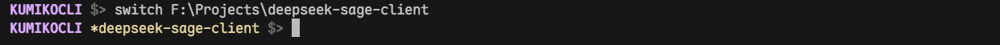
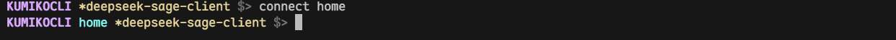
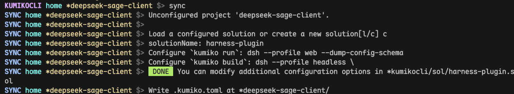

# KUMIKO CLI
以Git为脚手架的远程构建工具链。简单、易于上手、可拓展的Remote Dev选择。
<p align="center">
  
</p>

<p align="center">
  
  
  
  
  
  
  
</p>

KUMIKO CLI是基于Node.js开发的远程构建工具链。它使用了Git为脚手架，适合在Linux Server中运行，并通过OpenSSH对服务器进行管理。

## Quick Start 快速开始
如要快速开始，请克隆该仓库到一个空目录中。
```Bash
git clone https://github.com/OmaeKumiko529/kumiko-cli.git
```

确保你的环境安装了Node.js，然后通过以下指令构建并运行：
```Bash
npm install
npm run build
node dist/cli.js
```

随后，你就进入了KUMIKO CLI。


### 导入你的第一个库
KUMIKO CLI提供了非常方便的快捷指令。通常情况下，你不用做任何设置就可以导入一个已有git配置的库。即使你的项目没有git配置，KUMIKO CLI也会为你的项目创建一个。使用`switch`指令切换到项目根目录：

你会注意到此时的根目录处于被标记为*的状态，这是因为目录还没有上传到服务器，被视为本地目录。

然后使用`server`配置服务器。


将服务器挂载到工作区中：


随后第一次同步，并让工作区自动生成commit:


稍微等待一会即可。服务器成功挂载到工作区后，可以看到第一次提交记录。