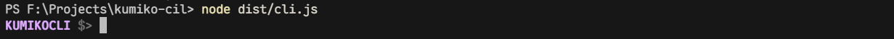
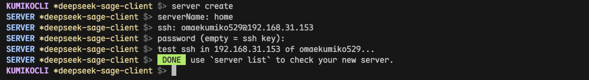
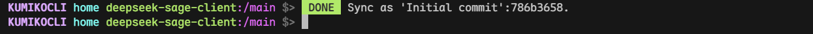

# KUMIKO CLI
以Git为脚手架的远程构建工具链。简单、易于上手、可拓展的Remote Dev选择。
<p align="center">
  
</p>

<p align="center">
  
  
  
  
  
  
  
</p>

KUMIKO CLI是基于Node.js开发的远程构建工具链。它使用了Git为脚手架，适合在Linux Server中运行，并通过OpenSSH对服务器进行管理。

## Quick Start 快速开始
如要快速开始，请克隆该仓库到一个空目录中。
```Bash
git clone https://github.com/OmaeKumiko529/kumiko-cli.git
```

确保你的环境安装了Node.js，然后通过以下指令构建并运行：
```Bash
npm install
npm run build
node dist/cli.js
```

随后，你就进入了KUMIKO CLI。


### 导入你的第一个库
KUMIKO CLI提供了非常方便的快捷指令。通常情况下，你不用做任何设置就可以导入一个已有git配置的库。即使你的项目没有git配置，KUMIKO CLI也会为你的项目创建一个。使用`switch`指令切换到项目根目录：

你会注意到此时的根目录处于被标记为*的状态，这是因为目录还没有上传到服务器，被视为本地目录。

然后使用`server`配置服务器。


将服务器挂载到工作区中：


随后第一次同步，并让工作区自动生成commit。因为是第一次配置，所以会系统让你选择解决方案。如果没有事先下载对某种语言的解决方案的话，就创建一个解决方案，然后填入最基本的`run`和`build`参数即可。


稍微等待一会即可。服务器成功挂载到工作区后，可以看到第一次提交记录。


这时你可以清晰地看到`Prompt`变为了：
```Bash
KUMIKOCLI home deepseek-sage-client:/main
```

它代表了三个常驻参数：
```Bash
KUMIKOCLI [server] [project]:[branch]
```
终端模式下（`switch current -terminal`）则显示为 `KUMIKOCLI [server] /[cwd]`；执行原生命令时，
首个参数会变成命令前缀，例如 `GIT [server] [project]:[branch]`。

进入到这一步，第一个库的配置就基本完成了。你可以查阅`kumiko help`来继续查看高级操作。

现在直接`sync`并`run`就可以通过remote的方式调试项目了。

### 常态命令行
KUMIKO CLI 内置了一个远端 shell：无法匹配 kumiko 命令的输入会被当成普通的 Linux 命令，
在已连接服务器的 `$HOME/kumiko` 下执行。命令前缀会显示成对应的工具名（`GIT`、`NPM`、`LINUX`……），
工作区、分支和当前目录都会出现在 `Prompt` 里：

```Bash
KUMIKOCLI home testProject:/main $> ls
LINUX home testProject:/main $> [*] testProject
                                ├── .git
                                ├── .kumiko.toml
                                ├── package.json
                                └── src
```

- 选中工作区与分支时，命令固定在工作区根目录执行，`cd` 会被禁用；
- `switch /` 回到空工作区，之后可以用 `cd` 自由浏览 `$HOME/kumiko`（`/projects`、`/logs`、`/repos`、`/run`）；
- `switch current -terminal` 把终端挂到当前工作区根目录（`/projects/<name>`），
  `switch current -kumiko` 再切回工作区模式；
- kumiko 配置存在于仓库中时，执行 `git` 命令会提示 `commond`；可用 `commond status|log|diff|add|commit|push|pull`
  执行常用 git 操作，或 `setting commond off` 关闭提示。

细节与设计权衡见 [docs/terminal-mode.md](docs/terminal-mode.md)。
